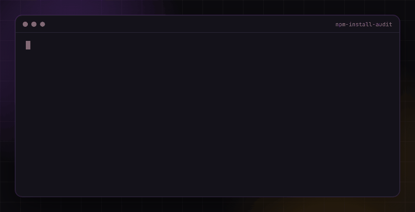

# npm-install-audit

<p align="center"></p>

A small Node script to run **before** `npm install` on a repo you did not write: a take-home test from a recruiter, a "quick look" project from a stranger, an unknown clone.

It reads `package.json` for install hooks (`preinstall`, `install`, `postinstall`, `prepare`) and scans `.js`, `.cjs`, `.mjs` and `.sh` files for patterns that fake interview repos and malicious packages tend to use.

No dependencies. No network. Read only.

## When to use it

You got a take-home test from a recruiter, or a stranger asked you to "just run the project". Before the first `npm install`, spend 5 seconds on this. Install hooks run automatically with your user rights, so that one command is where fake interview repos often steal SSH keys, cloud credentials and wallet files.

## Quick start

```
curl -O https://raw.githubusercontent.com/cryptostrapon/npm-install-audit/main/audit.js
node audit.js ./take-home-task
```

## Example output

```
$ node audit.js ./take-home-task
! package.json: postinstall hook runs: node scripts/setup.js
! scripts/setup.js: runs shell commands
! scripts/setup.js: decodes base64 at runtime
! scripts/setup.js: pipes a download into a shell

4 finding(s). Read them before you run npm install.
```

## Usage

```
node audit.js ./some-repo
```

Exit code is 1 if anything is flagged, 0 if clean, 2 if the path cannot be read. Run `node selftest.js` to check the script itself.

## What it flags

- install hooks that run a command
- shell execution (`child_process`, `execSync`, `spawn`)
- runtime code evaluation (`eval`, `new Function`)
- base64 decoding at runtime
- `curl | sh` and `wget | bash` pipes
- paths to SSH keys, cloud credentials, wallet files and browser data
- very long encoded strings

## Limits

A clean result is not proof of safety. Obfuscated code, code fetched later, and anything in `node_modules` (skipped on purpose) are out of scope. Expect some false positives, for example a legitimate `prepare` hook such as husky. Scanning this repo flags its own pattern list and self test, which is expected. Read the code and open unknown repos in a throwaway container or VM.

## Why

Fake recruiter repos with a poisoned `postinstall` are a common way wallets and credentials get stolen. Background: [malicious test project](https://cryptostrapon.com/stories/malicious-test-project) and [deepfake interviews](https://cryptostrapon.com/stories/deepfake-interviews).

**If this helped, please star the repo. It helps other developers find it.** ⭐

MIT licensed. Maintained by [CryptoStrapon](https://cryptostrapon.com).
