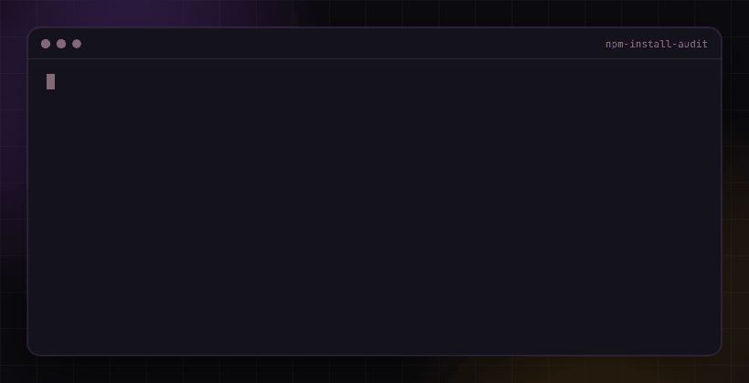

# npm-install-audit

[](https://github.com/cryptostrapon/npm-install-audit/actions/workflows/selftest.yml) [](https://github.com/cryptostrapon/npm-install-audit/releases) [](https://github.com/marketplace/actions/npm-install-audit) [](LICENSE)  [](https://github.com/cryptostrapon/npm-install-audit/stargazers)

<p align="center"></p>

A small Node script to run **before** `npm install` on a repo you did not write: a take-home test from a recruiter, a "quick look" project from a stranger, an unknown clone.

It reads `package.json` for install hooks (`preinstall`, `install`, `postinstall`, `prepare`) and dependencies that bypass the npm registry, and scans `.js`, `.cjs`, `.mjs`, `.jsx`, `.ts`, `.mts`, `.cts`, `.tsx` and `.sh` files for patterns that fake interview repos and malicious packages tend to use.

**New in 1.4:** it flags `.pnpmfile.cjs` hook files, a `yarnPath` that points Yarn at a binary inside the project, and project `.npmrc` settings that change how npm runs scripts (`script-shell`, `ignore-scripts=false`, `node-options`, `init-module`). All three checks were contributed by [@Doomguy-BFG9000](https://github.com/Doomguy-BFG9000).

**New in 1.3:** it checks `.npmrc`, `.yarnrc` and `.yarnrc.yml` for an auth token or a registry other than npmjs.org. A project from a stranger that ships its own token can install a package nobody can see on the public registry, which is how a recent fake Fiverr job hid its loader. The token itself is never printed.

**New in 1.1:** it also checks `.git/hooks`, `.git/config` and `.vscode/tasks.json`. A repo sent as a zip can carry active git hooks that run on `git pull`, `git checkout` or `git commit`, so the attack does not need `npm install` at all.

No dependencies. No network. Read only.

We also contributed a manual checklist for this situation to the [OWASP NPM Security Cheat Sheet](https://cheatsheetseries.owasp.org/cheatsheets/NPM_Security_Cheat_Sheet.html): the section "Inspecting a project you did not write" ([#2908](https://github.com/OWASP/CheatSheetSeries/pull/2908)).

## Who it is for

- **Developers job hunting:** a recruiter sends a take-home repo and asks you to "just run npm install".
- **Hiring and security teams:** a quick, read-only check before a repo from a candidate or vendor touches a laptop.
- **Open source maintainers:** look at a stranger's sample project or reproduction repo before running it.
- **CI:** `--json` output and exit codes make it easy to gate unknown code.

## When to use it

You got a take-home test from a recruiter, or a stranger asked you to "just run the project". Before the first `npm install`, spend 5 seconds on this. Install hooks run automatically with your user rights, so that one command is where fake interview repos often steal SSH keys, cloud credentials and wallet files.

## Quick start

With Node 18 or newer:

```
npx npm-install-audit ./take-home-task
```

In GitHub Actions, add one step after checkout and before any install step (details in [GitHub Action](#github-action)):

```yaml
- uses: cryptostrapon/npm-install-audit@v1.4.0
```

Or without npm, as a single file:

```
curl -O https://raw.githubusercontent.com/cryptostrapon/npm-install-audit/main/audit.js
node audit.js ./take-home-task
```

## Example output

```
$ node audit.js ./take-home-task
! package.json: postinstall hook runs: node scripts/setup.js
! scripts/setup.js: runs shell commands
! scripts/setup.js: decodes base64 at runtime
! scripts/setup.js: pipes a download into a shell

4 finding(s). Read them before you run npm install.
```

## Usage

```
node audit.js ./some-repo
node audit.js --json ./some-repo   # machine-readable output
node audit.js --version
```

With `--json` the findings are printed as a JSON array of `{ "file", "rule", "message" }` objects (`[]` when clean), which is handy in CI.

Exit code is 1 if anything is flagged, 0 if clean, 2 if the path cannot be read. Run `node selftest.js` to check the script itself.

## GitHub Action

Run the same check in a workflow, for example on a pull request from someone you do not know, before any install step:

```yaml
- uses: actions/checkout@v5
- uses: cryptostrapon/npm-install-audit@v1.4.0
  with:
    path: .                  # folder to check
    fail-on-findings: true   # set to false to only report
```

The step fails when anything is flagged and sets the `findings` output to the number of findings.

## What it flags

- install hooks that run a command
- `.pnpmfile.cjs` hook files, which pnpm runs during install even without a `package.json` install script
- dependencies that bypass the npm registry: git URLs (`git+https`, `git+ssh`, `git://`), `github:`/`gitlab:`/`bitbucket:` and bare `user/repo` shorthands, tarball and other URLs, `file:` and `link:` paths
- shell execution (`child_process`, `execSync`, `spawn`)
- runtime code evaluation (`eval`, `new Function`)
- base64 decoding at runtime
- `curl | sh` and `wget | bash` pipes
- paths to SSH keys, cloud credentials, wallet files and browser data
- project `.npmrc` overrides for `script-shell`, `ignore-scripts=false`, `node-options` and `init-module`, which change the programs or scripts npm runs
- very long encoded strings
- active git hooks in `.git/hooks` (anything that is not a `.sample` file), and hooks that download and run code
- risky `.git/config` entries: `core.hooksPath`, `core.fsmonitor`, `sshCommand`, `pager`, `editor`, aliases that run shell commands, filter and diff drivers
- VS Code tasks that run when the folder is opened (`"runOn": "folderOpen"`)
- `yarnPath` in `.yarnrc.yml`, which configures Yarn to run a project-supplied binary instead of the installed one (also common in legitimate projects)

## Before any git command

`git clone` never copies `.git/hooks`, so hooks only arrive when someone sends you the whole folder or a zip. If that happens, run the audit first, and run git with hooks turned off:

```
git -c core.hooksPath=/dev/null status
```

Open the folder in VS Code in Restricted Mode, so workspace tasks do not run.

## Limits

A clean result is not proof of safety. Obfuscated code, code fetched later, and anything in `node_modules` (skipped on purpose) are out of scope. Expect some false positives, for example a legitimate `prepare` hook or `core.hooksPath` set by husky. Scanning this repo flags its own pattern list and self test, which is expected. Read the code and open unknown repos in a throwaway container or VM.

## Changelog

- **1.4.0:** flags `.pnpmfile.cjs` hook files (#15), `yarnPath` pointing Yarn at a project binary (#17) and risky project `.npmrc` settings: `script-shell`, `ignore-scripts=false`, `node-options`, `init-module` (#18). Thanks @Doomguy-BFG9000.
- **1.3.2:** adds a GitHub Action (`action.yml`), so the same check can run in a workflow before any install step. No change to the checks.
- **1.3.1:** available on npm (`npx npm-install-audit ./repo`). Releases are published from GitHub Actions through npm trusted publishing, with provenance and no stored npm token. No change to the checks.
- **1.3.0:** flags `.npmrc` and Yarn config files that ship a registry auth token or point installs to a non-npmjs registry, including scoped `@scope:registry` entries.
- **1.2.1:** also scans `.jsx` and `.tsx` files, so code hidden in React components of a Next.js or Vite project is checked too.
- **1.2.0:** TypeScript files (`.ts`, `.mts`, `.cts`), `--json` output and non-registry dependency checks (thanks @ayushdwivedi-stack, #4); also flags `git://`, bare `user/repo`, `link:` and non-tarball URL dependencies.
- **1.1.0:** checks `.git/hooks`, risky `.git/config` entries and VS Code `folderOpen` tasks. `node audit.js --version` prints the version.
- **1.0.0:** install hooks and risky patterns in JS and shell files.

## Before a coding agent runs install

Coding agents can run `npm install` as soon as you ask them to set up a repo. If the repo came from someone you do not know, check it first and keep the agent from installing until you have read the findings:

```sh
npx npm-install-audit ./repo
```

To make this the default, add one line to the agent's instructions file (for example `AGENTS.md` or `CLAUDE.md`):

```text
Before running npm, yarn or pnpm install in this repo, run `npx npm-install-audit .` and stop if it reports findings.
```

The check only reads files, so it is safe to run before the agent does anything else. It does not replace reviewing the code the agent writes or runs later.

## Why

Fake recruiter repos with a poisoned `postinstall` are a common way wallets and credentials get stolen. Background: [malicious test project](https://cryptostrapon.com/stories/malicious-test-project) and [deepfake interviews](https://cryptostrapon.com/stories/deepfake-interviews).

**If this helped, please star the repo. It helps other developers find it.** ⭐

MIT licensed. Maintained by [CryptoStrapon](https://cryptostrapon.com).

## Show your support

If npm-install-audit flagged something nasty before it ran, a star helps other developers find it: ⭐ [star the repo](https://github.com/cryptostrapon/npm-install-audit/stargazers). Issues and PRs are welcome too — see [contributing](CONTRIBUTING.md) and the `good first issue` label.
